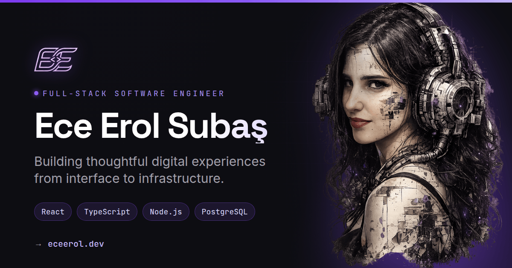

# Ece Erol Subaş — Portfolio

Personal portfolio for a full-stack software engineer. A single-page React site
(hero, about, experience, tech stack, projects, contact) backed by an Express
API that serves the project list and forwards contact messages by email.

**Live:** [eceerol.dev](https://eceerol.dev) · **API:** [portfolio-website-rzco.onrender.com](https://portfolio-website-rzco.onrender.com)



## Features

- Animated hero with a typed terminal card, magnetic call-to-action buttons and a downloadable CV
- Bento "About" grid with a scroll-triggered count-up stats row
- Vertical experience timeline with a scroll-linked progress rail
- Tech stack grouped by category, plus a marquee of the full toolkit
- Projects fetched live from the API, with skeletons, error/empty states, retry and a technology filter
- Contact form with matching client and server validation, toasts and a copy-email button
- Glass navbar with an active-section indicator, hide-on-scroll and an animated mobile menu
- Scroll progress bar, smooth scrolling (Lenis) and full `prefers-reduced-motion` support
- SEO: meta, Open Graph and Twitter tags, favicon set, `sitemap.xml`, `robots.txt`, JSON-LD `Person`

## Tech stack

| | |
| --- | --- |
| Frontend | React 19, TypeScript, Vite, Tailwind CSS 4, Framer Motion, Lenis, Axios |
| Backend | Node.js, Express 5, TypeScript, Zod, Helmet, express-rate-limit, Resend |
| Data | PostgreSQL, Prisma 7 |

## Architecture

```text
portfolio-website/
├── frontend/                 React SPA (Vite)
│   └── src/
│       ├── components/       layout, sections, ui
│       ├── data/             all copy: profile, content, experience, stats, tech stack
│       ├── hooks/            projects, active section, count-up, typewriter
│       ├── services/         axios client, projects, contact
│       └── lib/              animations, validation, smooth scroll, toasts
└── backend/
    ├── prisma/               schema and migrations
    └── src/
        ├── routes/           /api/projects, /api/contact
        ├── controllers/
        ├── services/         Prisma queries, Resend email
        ├── middlewares/      Zod validation, admin key, rate limit
        └── validators/
```

Requests flow `route → middleware → controller → service → database`.
`frontend/src/data/` is the source of truth for everything except the project
list, which comes from `GET /api/projects`.

### API

| Method | Endpoint | Access |
| --- | --- | --- |
| GET | `/health` | public |
| GET | `/api/projects` | public |
| GET | `/api/projects/:id` | public |
| POST | `/api/projects` | `x-api-key` header |
| PUT | `/api/projects/:id` | `x-api-key` header |
| DELETE | `/api/projects/:id` | `x-api-key` header |
| POST | `/api/contact` | public, 3 requests / 15 min / IP |

The admin key is compared in constant time against `ADMIN_API_KEY`.
Contact messages are HTML-escaped before they are emailed.

## Environment variables

Copy the examples and fill them in. Never commit real `.env` files.

**`backend/.env`** (see `backend/.env.example`)

| Variable | Purpose |
| --- | --- |
| `DATABASE_URL` | PostgreSQL connection string |
| `PORT` | API port (Render sets this; defaults to 3000) |
| `CLIENT_URL` | Deployed frontend origin allowed by CORS |
| `ADMIN_API_KEY` | Secret for `x-api-key` on project writes |
| `RESEND_API_KEY` | Resend API key for the contact form |
| `CONTACT_EMAIL` | Inbox that receives contact messages |

**`frontend/.env.development`** (see `frontend/.env.example`)

| Variable | Purpose |
| --- | --- |
| `VITE_API_URL` | API base URL, without `/api` (e.g. `http://localhost:3000`) |

## Local setup

Requires Node.js 22+ and a running PostgreSQL database.

```bash
# API
cd backend
npm install
cp .env.example .env          # then edit it
npx prisma migrate dev
npm run dev                   # http://localhost:3000

# Site (second terminal)
cd frontend
npm install
cp .env.example .env.development
npm run dev                   # http://localhost:5173
```

Create a project:

```bash
curl -X POST http://localhost:3000/api/projects \
  -H "content-type: application/json" \
  -H "x-api-key: $ADMIN_API_KEY" \
  -d '{"title":"My App","description":"...","techStack":["React","TypeScript"]}'
```

## Scripts

| | `npm run dev` | `npm run build` | other |
| --- | --- | --- | --- |
| `frontend/` | Vite dev server | typecheck, production build, prerender | `lint`, `typecheck`, `preview` |
| `backend/` | `tsx watch` | `tsc` + path alias rewrite | `start` runs `dist/` |

The frontend build prerenders the page into `index.html`, so the first paint
does not wait for JavaScript. React hydrates it on load.

## Deployment notes

- Set `ADMIN_API_KEY`, `RESEND_API_KEY`, `CONTACT_EMAIL` and `CLIENT_URL` on the API host. `POST`/`PUT`/`DELETE /api/projects` return 503 until `ADMIN_API_KEY` is set.
- The API trusts the first proxy (`trust proxy = 1`) so rate limiting sees the real client IP behind Render.
- `CLIENT_URL` must be the exact frontend origin (for example `https://eceerol.dev`). `http://localhost:5173` is always allowed.
- Contact mail is sent from Resend's `onboarding@resend.dev` until a custom domain is verified.
